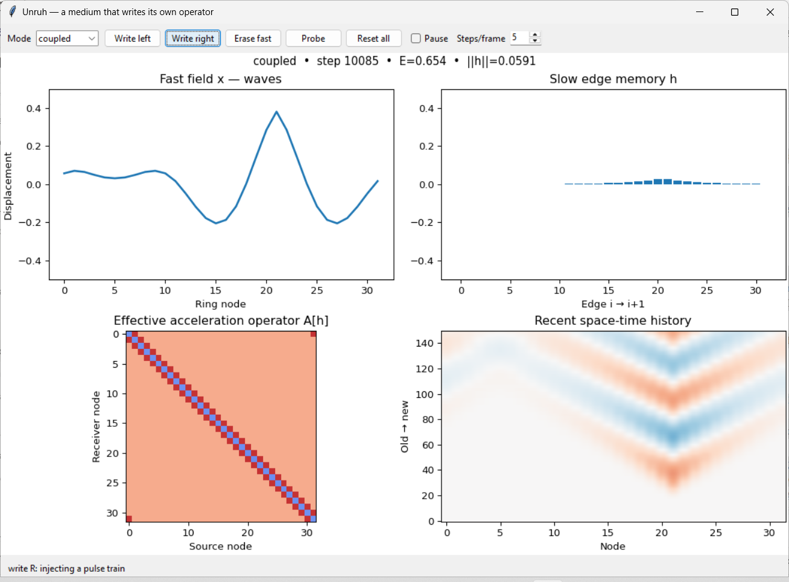

# Unruh — a medium that writes its own operator



A small, falsifiable classical experiment inspired by a simple question:
**what if the matrix doing the computation is generated by a faster physical-like system, remembers that system, and acts back on it?**

This is **not** a simulation of quantum fields, Unruh radiation, general relativity, or consciousness. The name is an inspiration from analogue-gravity thinking, not a claim of reproducing Unruh's equations. What we actually build is a ring of coupled damped oscillators with plastic edge stiffnesses.

## Run it

Python 3.10+; NumPy required. The GUI additionally requires Matplotlib and a Python installation with Tkinter (usually included on Windows).

```bash
python -m pip install -r requirements.txt
python unruh.py gui
```

Use **Write left** or **Write right** to excite a spatial region. The local fast oscillations gradually write a slow correlation pattern `h`. Press **Erase fast** to explicitly set `x = v = 0` while retaining `h` (except in the instant model), then **Probe** to inject the *same* stimulus from node zero. Try switching to `observer`, `frozen` or `instant`. The four panels show the waves, the slow edge memory, the effective matrix `A[h]`, and a scrolling space-time strip.

```bash
python unruh.py bench
python -m unittest discover -s tests -v
```

The benchmark saves `results/benchmark.json`. Customize with `--seeds`, `--train-pairs`, `--test-pairs`, `--feedback`, `--tau`, `--output`.

## Exact toy dynamics

For ring site `i`, let `x_i` be displacement, `v_i` velocity and `h_i` the slow state of the edge from site `i` to `i+1` (indices modulo N). The stiffness is

```
k_i = k0 (1 + feedback * h_i)          # coupled/instant
k_i = k0                              # frozen/observer
```

and the integrated acceleration is

```
v_dot_i = k_i*(x_{i+1}-x_i) - k_{i-1}*(x_i-x_{i-1})
          - onsite*x_i - damping*v_i - cubic*x_i**3 + input_i + noise_i
x_dot_i = v_i
h_dot_i = (tanh(gain*x_i*x_{i+1}) - h_i)/tau
```

We use semi-implicit Euler (`v` then `x`). `h` is bounded under the default integration; `feedback < 1` keeps all edge stiffnesses positive. `A[h]` is the sparse symmetric matrix representing the spring and onsite terms. The effective operator is *not* a stored learned weight matrix: it is continuously constructed from the changing medium's slow state. But it is also not spacetime curvature; `A[h]` is simply a state-dependent stiffness operator.

## Four matched ablations

| Mode | Slow edge state remembers activity? | Slow state changes wave propagation? |
|---|---|---|
| `coupled` | Yes, low-pass correlations | Yes |
| `frozen` | No | No |
| `instant` | No, only current correlation | Yes, instantaneously |
| `observer` | Yes | No |

All modes use the same ring size, input, damping, noise and readout. `observer` tracks `h` without allowing feedback: a matrix can contain a memory without that memory being readable through the world. `instant` controls for state-dependent nonlinearity without a persistent slow store.

## The causal readout experiment

Each independent trial receives a noisy oscillating write input at one of two sites (binary label). We then **erase every fast `x` and `v` value**. This is an artificial identification intervention, *not* an assertion that a real brain has such a reset. The slow state is left alone. We deliver a standard probe at node 0, measure only `x` at six remote nodes across time, and ask a simple **linear nearest-centroid classifier** to tell which site was written.

For each nuisance seed we evaluate *both labels* with exactly matched drive amplitude, write phase, stochastic noise and probe. Training and testing use disjoint nuisance seeds. Thus none of the ablations without a write-dependent causal memory can exceed 50% in this paired protocol except through implementation error. Labels are never fed into the probe or decoder. The reader never accesses `h` directly.

Reference run (`python unruh.py bench --seeds 3 --train-pairs 20 --test-pairs 20`):

| Mode | Mean held-out accuracy | Mean template separation |
|---|---:|---:|
| coupled | **98.3%** | 0.020893 |
| frozen | 50.0% | 0 |
| instant | 50.0% | 0 |
| observer | 50.0% | 0 |

Three independent seeds, 40 held-out observations each. Exact records and parameters in [`results/reference.json`](results/reference.json). This is a demonstration of an intentionally engineered mechanism, **not evidence that some new law of physics emerged**. The deliberately paired controls have identical post-erasure probe trajectories by construction, so 50% is expected rather than an empirical surprise.

Try `python unruh.py bench --feedback 0` to eliminate the causal handle. If the coupled result then remains above chance, the experiment has a bug. With feedback restored, histories create different edge operators and different responses to the same subsequent question.

## A stronger scientific question

The code establishes *causal, history-dependent effective connectivity*, not autonomous physics or awareness. To ask whether an actual higher-level world has formed, we would need harder tests: robust long-distance propagation of effective excitations, closed dynamics for coarse-grained variables, transfer of learned laws between microstates, invariance under reimplementation, and genuinely new predictive power versus a matched recurrent state of equal capacity. None is claimed here.

The difference worth keeping: **a second-order relationship can be more than a report about the first level; it can become a slow causal degree of freedom that the first level must subsequently obey.**

## V2: measuring a law for the slow medium

V2 is a deliberately stricter test of the 'world inside a world' idea. **It does not add
direct diffusion or spatial coupling between slow edges.** Instead, it keeps the
original microscopic dynamics and switches to a stationary DC pump, giving the
fast x/v fields time to settle at an equilibrium x*(h) for each slow configuration.

A second-level law can then be *measured*:

```text
0 = A[h] x*(h) - cubic*x*(h)^3 + constant_force
T_i(h) = tanh(gain * x*_i(h) * x*_(i+1)(h))
J_ij   = d T_i(h) / d h_j | at driven equilibrium

dh/dt ≈ (T(h*) + J (h-h*) - h) / tau
```

The last equation operates **only on h**. The original system has no h-to-h
coupling, but the measured J has nonzero off-diagonal elements because perturbing
an edge stiffness changes the *fast* equilibrium displacement elsewhere, which in
turn changes the slow writing rate there. A new matrix has emerged from the
dynamics of the first matrix. This is an adiabatic, driven effective law, not
fundamental spacetime physics.

Run the interactive second-level experiment:

```bash
python slow_world_gui.py
```

Or start the original GUI (`python unruh.py gui`) and press
**Slow world V2**. The original GUI now highlights changes in the effective
operator (ΔA relative to the fresh medium) and rescales the slow-memory panel:
the default previous heatmap was visually saturated by the diagonal.

Reproduce the quantitative test and save a three-panel diagnostic PNG:

```bash
python emergence.py --plot
python -m unittest discover -s tests -v
```

A fixed, spatially alternating DC drive pumps a 24-edge ring. A series of 2N+1
clamped slow-edge interventions measures the Jacobian J of the equilibrated
writing law. Held-out evaluation then compares **open-loop h-only forecasts**
against 12 **fully simulated** trajectories with new slow initial conditions and
new fast x/v perturbations. Prediction begins from h alone; it never calls a fast
solver during rollout.

| Forecast (12 held-out trials, physical horizon 120) | Mean RMSE ↓ |
|---|---:|
| Full measured slow Jacobian | **0.001387** |
| Nearest-neighbor-only Jacobian | 0.002265 |
| Independent-edge Jacobian | 0.002917 |
| Decay to a calibrated fixed point | 0.003015 |
| Persistence | 0.022371 |

Full Jacobian beats independent-edge and decay models on all 12 held-out
trials, and the nearest-neighbor version on 11/12. This is a local
linearized response model, not a learned general-purpose physics engine.
Different model classes have different effective capacity and this protocol
calibrates around one driven equilibrium: both are important limitations.

A single slow-edge pulse (magnitude 0.2 at edge 7) causes a maximum
**0.010397** off-site change in h. With feedback zero, the matched
off-site response is **exactly zero**. The maximum off-diagonal
Jacobian entry is **0.343750**. Removing the pump removes the maintained
fast equilibrium and invalidates the calibrated law. The induced slow response
is primarily a spatially distributed **relaxation**, not evidence of a
freely propagating slow wave.

A lightweight snapshot is saved at
[results/slow_world_summary.json](results/slow_world_summary.json).
The command generates its full trace JSON and PNG locally.

### What this does *not* establish

This is a *driven, dissipative*, classical oscillator system with deliberately
engineered slow memory, so the existence of an approximate effective slow law
is expected from timescale separation. It does **not** demonstrate quantum
effects, consciousness, self-sustaining autonomous physics, or independence
from its substrate. It establishes a testable step toward a coarse-grained
level: a response operator whose off-diagonal interactions are generated
by — and feed back through — a faster one.
